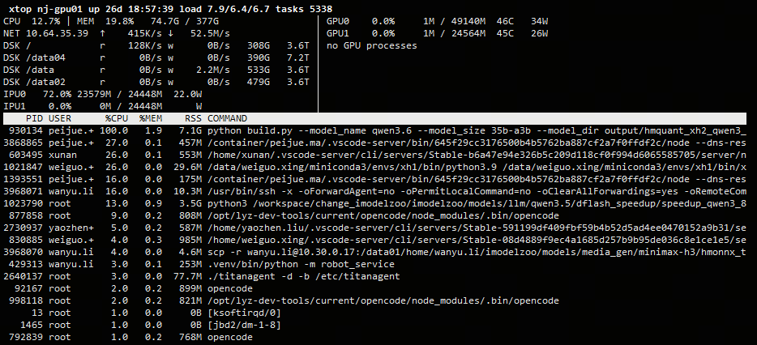
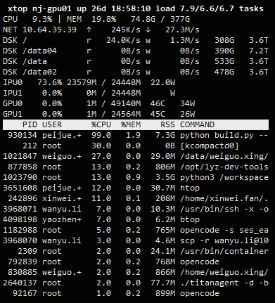

# xtop

80 列终端里的只读资源监控。要求 Python 3.8+，默认由标准库实现，无第三方依赖。

## 界面预览

### 宽终端



### 窄终端



预览图使用了 `--disk-rate`，因此包含磁盘实时读写速率。

## 安装

```sh
pip install dist/xtop-0.1.0-py3-none-any.whl
xtop
```

推荐安装 NVML 后端，GPU 查询更轻量、稳定；未安装时自动回退到
`nvidia-smi`：

```sh
pip install '.[gpu]'
```

开发时：

```sh
pip install -e .
```

## 用法

```sh
xtop                    # 主机每 1 秒采样，界面像 top 一样每 3 秒刷新
xtop -d 2               # CPU、磁盘、网络、进程每 2 秒采样
xtop --refresh 0.5      # 界面刷新间隔，秒
xtop --disk-rate        # 额外显示磁盘实时读写速率
```

GPU 使用独立频率：NVML 指标/进程为 1/2 秒，`nvidia-smi` 回退为 2/4 秒，
磁盘设备和挂载拓扑每 30 秒刷新。一次查询失败时保留最近成功数据，连续
失败会逐步退避到最多 30 秒。没有 GPU 或驱动时静默跳过。

后摩 IPU 指标每 1 秒查询一次。单张设备异常时仍更新其他设备，并保留异常
设备最近一次成功的数据；连续失败同样逐步退避。没有后摩 SDK 或设备时不
影响主机和 GPU 信息采集。

`q` 退出，空格暂停显示，`r` 立即刷新，`s` 切换进程排序，方向键滚动。

## 显示

顶栏是主机、运行时间、load、任务数。下面每类设备一行：

- CPU 占用，内存占用和用量
- 每张后摩 IPU 一行：占用、DDR 用量、板卡功耗
- 每张 GPU 一行：占用、显存、温度、功耗
- 有 IPv4 地址的网卡：上下行带宽
- 物理磁盘：按挂载点排序，默认显示挂载点、空闲和总量；`--disk-rate` 额外显示读写带宽

其余空间是进程表，包含 root。列为 PID、USER、CPU、MEM、RSS、COMMAND。数字
右对齐，单位紧贴数字；终端变窄时进程命令从右侧直接截断。

界面主体使用终端默认前景和背景色，进程表头使用类似 `top` 的白底黑字。
摘要区的数值列保持对齐；网卡 IP 和磁盘挂载点共用一个动态列宽，取当前
内容的最大长度，最多 19 个字符，超出时直接裁切。第二列之后固定留两个
空格，再从同一位置开始显示后续信息。整行超出屏幕时从右侧自然截断。
终端足够宽且存在 GPU 时，上方区域以竖线分栏：主机摘要在左，GPU 摘要和
GPU 计算进程在右；分割线随左侧内容在 40～62 列之间调整，系统进程表仍在
下方占满整行。窄终端保持纵向摘要布局。

## 数据来源

`/proc` 读 CPU、内存、磁盘、网络和进程。后摩 IPU 通过 Houmo SDK 的
`postmo_smi` C API 查询。GPU 优先使用可选的 NVML Python 绑定，失败时调用
`nvidia-smi`，两者都没有则跳过。IPU 和 GPU 在独立线程采集，驱动异常不会
阻塞界面和主机信息。磁盘只统计有硬件节点的整盘，挂载点通过 sysfs 的
device-mapper 名字还原。
